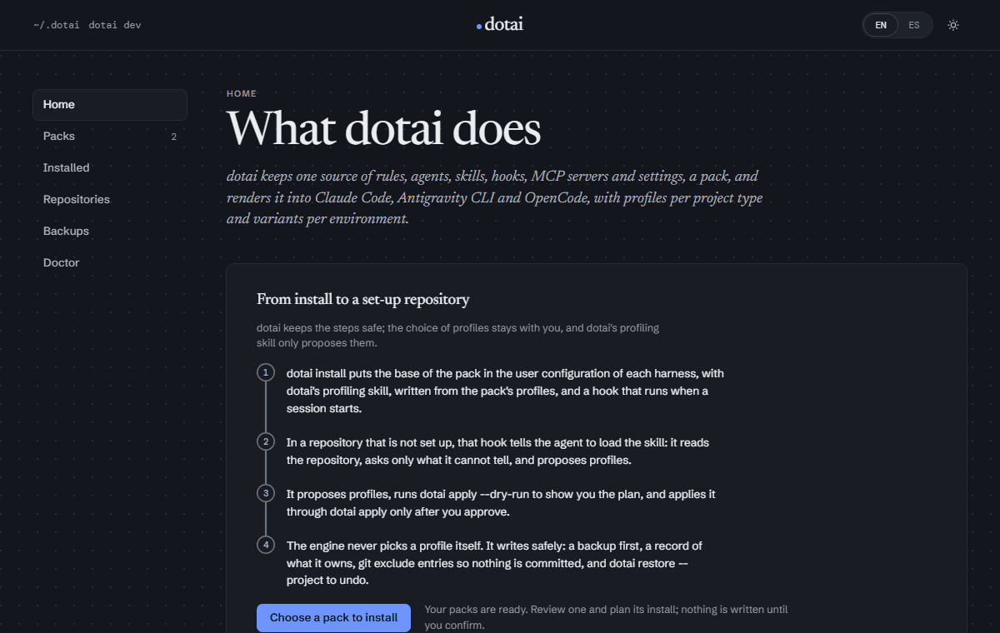

# dotai

[](https://github.com/lartweib/dotai/actions/workflows/ci.yml)
[](LICENSE)
[](https://pkg.go.dev/github.com/lartweib/dotai)
[](go.mod)

Cross-harness configuration engine for AI coding agents.

Each AI coding harness keeps its rules, agents, skills, hooks, MCP servers and settings in its own files and formats, so a setup you care about drifts apart across tools and machines, and trying a new one means hand-editing configuration you cannot easily undo. dotai keeps that setup in one place, a **pack**, and renders it into Claude Code, Google Antigravity CLI (agy) and OpenCode, with profiles per project type and variants per environment. Every write is planned first, shown before it happens, backed up, and undone with `dotai restore`: an install can run isolated from your own configuration, and a project's files stay out of git.



## Features

- **One source, three harnesses.** A pack in the [rulesync](https://github.com/dyoshikawa/rulesync) layout, rendered by a pinned rulesync binary whose checksums are embedded in the engine.
- **Plan first.** Every command that writes shows its exact file and key operations with `--dry-run`, and `--json` gives the same plan to scripts ([CLI JSON output](docs/CLI-JSON.md)).
- **Safe by default.** Isolated installs under `~/.dotai/isolated/`, or a replace mode that resets a harness to a fresh install; a backup before every write, a journal and a rollback on failure, and `dotai restore` to undo.
- **Project profiles that stay local.** `dotai apply --profile <p>` writes only to local, untracked files, lists them in `.git/info/exclude`, and `dotai restore --project` undoes it.
- **Packs from GitHub or a folder.** `dotai pack add`, `update` (which shows what changed in hooks, MCP servers, settings, tools and mods first), `remove`, `list`, and `dotai pack new` from an embedded template.
- **A local web UI.** `dotai ui` serves the same use cases on `127.0.0.1`, each action shown as its plan first.
- **`dotai doctor`** reports what changed outside dotai since it wrote it.

## Supported harnesses and platforms

| Harness | Pack id | Command | Isolated launch | Status |
|---|---|---|---|---|
| Claude Code | `claudecode` | `claude` | `CLAUDE_CONFIG_DIR` | Supported |
| Google Antigravity CLI (agy) | `antigravity-cli` | `agy` | `--gemini_dir` | Supported |
| OpenCode | `opencode` | `opencode` | `XDG_*` directories | Preview |

OpenCode is a preview, pending an upstream fix in rulesync's generated OpenCode hooks plugin: hooks that read stdin can hang, and hook timeouts are not enforced. An install never selects a preview harness by default: name it with `--harness`, or tick it in the web UI's harness step, and the plan warns `harness-preview`; the saved choice, or an earlier install of the pack that managed it, keeps it managed.

Isolation is partial for every harness: each install plan names what of your own setup still loads, such as a shared login. The verified behavior of each harness, with the version and OS it was checked on, is in [Harness notes](docs/HARNESS-NOTES.md).

| OS | Architectures |
|---|---|
| Windows | x64 (`amd64`) |
| Linux | x64 (`amd64`), arm64 |
| macOS | x64 (`amd64`), arm64 |

These are the platforms of the release archives and of the rulesync checksums the engine embeds ([0042](docs/decisions/0042-tag-driven-release-binaries.md)). CI runs on Windows, Linux and macOS. Adding or updating a pack from GitHub needs git 2.41 or later on `PATH`, and a project apply uses git to find the files a repository tracks.

## Install

### One command

On Linux and macOS:

```sh
curl -fsSL https://raw.githubusercontent.com/Lartweib/dotai/main/install.sh | sh
```

On Windows, in PowerShell:

```powershell
irm https://raw.githubusercontent.com/Lartweib/dotai/main/install.ps1 | iex
```

These commands work once the first release, `v0.1.0`, is published; until then the script stops with "no release found".

The script installs the latest release for your platform ([0048](docs/decisions/0048-one-command-install-scripts.md)). It downloads the archive and `SHA256SUMS` over HTTPS, with curl or, when curl is missing, wget, into a temporary directory. It verifies the archive's checksum and stops before extracting anything if it does not match, then puts `dotai` in `~/.local/bin` (`%LOCALAPPDATA%\Programs\dotai` on Windows) and runs `dotai version`. It needs no sudo or administrator rights. On Windows, a failed update puts the previous `dotai.exe` back; close a running `dotai`, such as `dotai ui`, if the script asks you to.

When that directory is not on your `PATH` already, the script puts it there:

- `install.sh` appends two lines, `# added by the dotai installer` and `export PATH='<dir>':"$PATH"`, to the profile of the shell in `$SHELL`: `~/.zshrc` for zsh; `~/.bashrc` for bash, and on macOS also the first of `~/.bash_profile`, `~/.bash_login` and `~/.profile` that exists (`~/.bash_profile` when none does); or `~/.config/fish/conf.d/dotai.fish` with `fish_add_path` for fish. A profile that has the line for that directory already is left as it is. For any other shell, or when the profile cannot be written, it prints the line to add by hand.
- `install.ps1` appends the directory to your user `Path` (`HKCU\Environment`), keeping the existing value and entries such as `%USERPROFILE%` unexpanded, and to the `Path` of the current session.

Either way the script says what it changed; new terminals pick it up.

Options go after `sh -s --`, or as variables on the side of the pipe that runs the script, not on `curl`: `DOTAI_VERSION=0.1.0 curl ... | sh` sets the variable for `curl` only, and the script never sees it.

```sh
curl -fsSL https://raw.githubusercontent.com/Lartweib/dotai/main/install.sh | sh -s -- --version 0.1.0 --no-modify-path
curl -fsSL https://raw.githubusercontent.com/Lartweib/dotai/main/install.sh | DOTAI_INSTALL_DIR="$HOME/bin" DOTAI_NO_MODIFY_PATH=1 sh
```

```powershell
$env:DOTAI_VERSION = '0.1.0'; $env:DOTAI_NO_MODIFY_PATH = '1'; irm https://raw.githubusercontent.com/Lartweib/dotai/main/install.ps1 | iex
```

- `DOTAI_VERSION` (or `--version`) installs a given release instead of the latest.
- `DOTAI_INSTALL_DIR`, an absolute path, installs elsewhere.
- `DOTAI_NO_MODIFY_PATH=1` (or `--no-modify-path`) changes no profile or `Path` and only prints the line to add.
- `DOTAI_RELEASE_BASE_URL` replaces `https://github.com/Lartweib/dotai/releases`, for tests and mirrors. It must be an `https` URL; plain `http` is accepted only on `127.0.0.1` and `localhost`.

To read the script before running it, download it first, then run the file:

```sh
curl -fsSLo install.sh https://raw.githubusercontent.com/Lartweib/dotai/main/install.sh
less install.sh
sh install.sh
```

On Windows, `irm https://raw.githubusercontent.com/Lartweib/dotai/main/install.ps1 -OutFile install.ps1`, read it, then run `powershell -ExecutionPolicy Bypass -File install.ps1`.

### From a release

Each release on [github.com/lartweib/dotai/releases](https://github.com/lartweib/dotai/releases) has an archive per platform and a `SHA256SUMS` file. The archives are named `dotai_<version>_<os>_<arch>.tar.gz`, or `.zip` for Windows; below, `<archive>` is the one you downloaded.

1. Download the archive for your platform and `SHA256SUMS` from the same release.
2. Verify the checksum in the download directory:
   - Linux: `grep <archive> SHA256SUMS | sha256sum --check`
   - macOS: `grep <archive> SHA256SUMS | shasum -a 256 --check`
   - Windows (PowerShell): `(Get-FileHash <archive>).Hash`, and compare it with the line for that file in `SHA256SUMS`.
3. When the release carries a build provenance attestation, verify it with the GitHub CLI: `gh attestation verify <archive> --repo lartweib/dotai`.
4. Extract the archive and put `dotai` (`dotai.exe` on Windows) in a directory on your `PATH`, such as `~/.local/bin`.
5. Check it with `dotai version`.

### From source

With Go 1.26 or later:

```sh
go install github.com/lartweib/dotai/cmd/dotai@latest
```

## Quickstart

Create a pack, check it, see what an install would do, install it isolated, launch a harness against it, and open the UI. The example uses Claude Code; use the harness you have instead (`claudecode` or `antigravity-cli`, or `opencode` as a preview), which must already be installed. The first install downloads the pinned rulesync once and verifies its checksum.

```sh
dotai pack new my-pack --name my-pack --harness claudecode --profile web:"Web projects"
dotai validate my-pack
dotai install my-pack --mode isolated --dry-run   # then again without --dry-run
dotai run claudecode
dotai ui
```

- `dotai pack new` writes dotai's template, one commented example of each file a pack holds, and adds the pack to the registry. Edit the examples: a file left as the template wrote it is flagged `template-unchanged`, and `install` asks before installing it.
- `dotai install --mode isolated` installs under `~/.dotai/isolated/`, never into your own harness configuration; `dotai restore` undoes it.
- `dotai run claudecode` launches Claude Code against the isolated install; pass the harness's own arguments after `--`.
- `dotai install` manages the pack's harnesses that are installed on your machine, or those `--harness` names. The pack lists the harnesses it is compatible with in `harnesses` and those it cannot do without in `requires`: a missing required harness stops the install, and a preview harness, such as OpenCode, is managed only when `--harness` or the saved choice names it, or the previous install of the pack managed it ([Pack format](docs/PACK-FORMAT.md#manifest)).

For a complete, small pack to read, see [examples/minimal-pack](examples/minimal-pack/README.md). [Creating a pack](docs/PACK-FORMAT.md#creating-a-pack) covers `dotai pack new` in full, and [Applying a pack](docs/PACK-FORMAT.md#applying-a-pack) the project profiles.

## Docs

- [Architecture](docs/ARCHITECTURE.md): how the engine works and the code map.
- [Pack format](docs/PACK-FORMAT.md): the pack contract.
- [CLI JSON output](docs/CLI-JSON.md): every command, its `--json` data, and the web UI API.
- [Harness notes](docs/HARNESS-NOTES.md): verified harness behavior.
- [Decision records](docs/decisions/README.md): why the engine is built this way.
- [Roadmap](docs/ROADMAP.md): what is done and what comes next.
- [Changelog](CHANGELOG.md).

## Contributing

Contributions are welcome. Read [CONTRIBUTING.md](CONTRIBUTING.md) first, and follow the [Code of Conduct](CODE_OF_CONDUCT.md). Report security issues privately, as [SECURITY.md](SECURITY.md) describes.

## License

[MIT](LICENSE)
