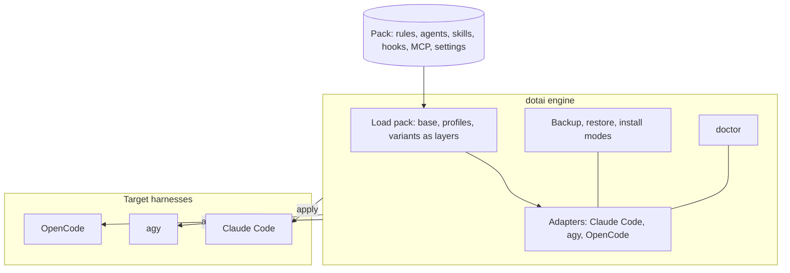
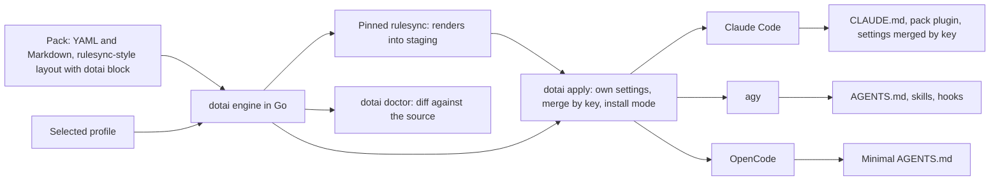
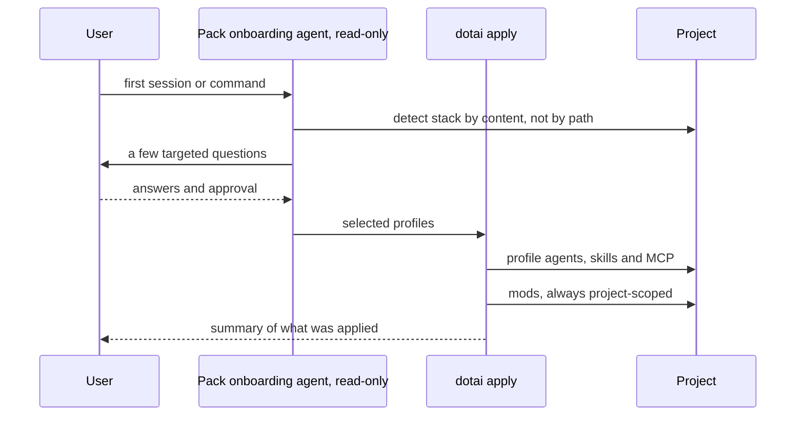

# Architecture

- **Status:** design, no code. Describes the planned v1 architecture of the engine as decided.
- **verified-at:** 2026-10-26
- **covers:** [0004](decisions/0004-installer-language-and-shape.md) (partial), [0007](decisions/0007-always-on-context-budget.md) (proposed), [0008](decisions/0008-onboarding-by-detection-and-base-profile.md), [0010](decisions/0010-engine-and-pack-separated.md), [0011](decisions/0011-mods-always-project-scoped.md), [0012](decisions/0012-rules-file-per-harness.md), [0013](decisions/0013-renderer-merges-by-key.md), [0016](decisions/0016-review-via-external-tracker.md), [0017](decisions/0017-pack-variants-as-layers.md), [0018](decisions/0018-install-modes-and-mandatory-backup.md), [0019](decisions/0019-v1-harness-targets.md), [0020](decisions/0020-v1-scope-engine-and-pack.md), [0021](decisions/0021-go-engine-orchestrates-rulesync.md), [0022](decisions/0022-pack-format-and-manifest.md), [0023](decisions/0023-flat-profiles-and-layer-merge-rules.md), [0024](decisions/0024-models-declared-per-harness-no-tiers.md), [0025](decisions/0025-settings-as-per-harness-passthrough.md), [0026](decisions/0026-json-cli-and-ui-after-v1.md)

This document is a map, not an atlas. The why lives in the [decision records](decisions/README.md) and the pack contract in [PACK-FORMAT.md](PACK-FORMAT.md). Anything not yet decided is marked as pending and points to [OPEN-QUESTIONS.md](OPEN-QUESTIONS.md). Anything not stated by a source document is marked `(inferred)`.

The runtime of the reference pack (delegation, hooks, review, task router) is described in its own repository: [RUNTIME.md](../../dotai-lartweib-pack/docs/RUNTIME.md).

## 1. What it is

`dotai` is a Go binary that renders a single configuration source (rules, agents, skills, hooks, settings, profiles) to Claude Code, agy and OpenCode. Everything opinionated (policies, modules, workflows) comes from a pack; the engine contains nothing personal ([0010](decisions/0010-engine-and-pack-separated.md)). Controlled token consumption is a central goal: every always-on piece justifies its cost ([0007](decisions/0007-always-on-context-budget.md), proposed).

## 2. Overview

dotai is a Go engine that loads a pack and applies it to the target harnesses ([0010](decisions/0010-engine-and-pack-separated.md)), using a pinned rulesync for rendering ([0021](decisions/0021-go-engine-orchestrates-rulesync.md)). The engine's v1 scope is in [0020](decisions/0020-v1-scope-engine-and-pack.md). Review tools are external and declared by the pack ([0016](decisions/0016-review-via-external-tracker.md)). The harnesses are the targets ([0019](decisions/0019-v1-harness-targets.md)); environment-specific setups, such as an optional orchestrator, are pack variants applied as layers ([0017](decisions/0017-pack-variants-as-layers.md)).

## 3. Planned code map

There is no code. The only thing decided is the shape ([0004](decisions/0004-installer-language-and-shape.md), in force where 0020 does not replace it, 0010 to 0013, and 0021):

- **Separate engine and packs** ([0010](decisions/0010-engine-and-pack-separated.md)): the engine is an own, minimal Go binary that orchestrates a pinned rulesync binary for rendering ([0021](decisions/0021-go-engine-orchestrates-rulesync.md)); packs are YAML + Markdown, and nothing personal goes into Go.
- **Pack source in the `.rulesync/` layout:** per-harness blocks in the frontmatter (`claudecode:`, `opencode:`, and for agy `antigravity-cli:` in subagents and `antigravity:` in rules) and a `dotai:` block with abstract capabilities, which dotai reads from the sources because rulesync strips it ([0021](decisions/0021-go-engine-orchestrates-rulesync.md), [HARNESS-NOTES](HARNESS-NOTES.md)).
- **Rendering:** rulesync renders rules, commands, subagents, skills, MCP, hooks and permissions into a staging directory; dotai renders what rulesync does not cover (settings such as `statusLine` and `env`, plugins, runners) and applies everything with merge by key and the active install mode ([0021](decisions/0021-go-engine-orchestrates-rulesync.md)).
- **Rules file per harness:** `CLAUDE.md` for Claude Code and `AGENTS.md` for agy and OpenCode, from the same source ([0012](decisions/0012-rules-file-per-harness.md)).
- **Emission in Claude Code:** skills, commands, agents, hooks, MCP and mods in one plugin per pack; `permissions`, `env` and `statusLine` in settings, merged by key with an ownership record and without deleting foreign entries ([0013](decisions/0013-renderer-merges-by-key.md)).
- `dotai apply --harness claude|opencode|agy --profile <profile> [--project .]`; to use another pack, for example `--pack <source>` ([0010](decisions/0010-engine-and-pack-separated.md); exact form pending).
- Every command offers `--json` output; a UI (local web page or terminal) comes after v1 as a thin layer over the same functions ([0026](decisions/0026-json-cli-and-ui-after-v1.md)).
- `dotai doctor`: diffs the generated output against the source. It is planned to also measure the first-request budget and fail if it exceeds the cap the pack declares ([0007](decisions/0007-always-on-context-budget.md), proposed).
- `dotai decision` (numbers decisions and regenerates the decision index) and `dotai skills get <x>`: a skill can ship as a stub whose `SKILL.md` holds only the description and loads its full guide from the binary, so the always-on cost is only the description and the guide does not drift from the code (the pattern Orca uses with `orca skills get <x>`). Exact subcommands: pending design.

Pending:

- Pack format: decided in [0022](decisions/0022-pack-format-and-manifest.md), specified in [PACK-FORMAT.md](PACK-FORMAT.md). Models are declared per harness in each subagent, without tiers ([0024](decisions/0024-models-declared-per-harness-no-tiers.md)). Settings are per-harness blocks merged as-is ([0025](decisions/0025-settings-as-per-harness-passthrough.md)).

## 4. Project onboarding

Decided in [0008](decisions/0008-onboarding-by-detection-and-base-profile.md). The onboarding agent comes from the pack; the engine applies what the user approves. Mods are always installed at project level (invariant, see §5).

## 5. Invariants

- Mods are always installed at project or local level, never at user level ([0011](decisions/0011-mods-always-project-scoped.md)).
- Skills and agents are installed per profile, never globally ([0008](decisions/0008-onboarding-by-detection-and-base-profile.md)).
- Single source of rules in the pack, rendered to `CLAUDE.md` in Claude Code and to `AGENTS.md` in agy and OpenCode ([0012](decisions/0012-rules-file-per-harness.md), which on that point replaces [0003](decisions/0003-align-with-official-standards.md)).
- The renderer never rewrites a file with foreign content: it merges by key and only removes what it recorded as its own ([0013](decisions/0013-renderer-merges-by-key.md)).
- The engine knows no specific tool such as Orca; anything tool-specific is a pack variant ([0017](decisions/0017-pack-variants-as-layers.md)).

## 6. Boundaries and external integrations

dotai does not control these surfaces: it uses them and can break if they change. Verified facts are in [HARNESS-NOTES.md](HARNESS-NOTES.md).

| System | What dotai uses | Source and notes |
|---|---|---|
| **rulesync** | Pinned binary that renders rules, commands, subagents, skills, MCP, hooks and permissions into staging; per-target frontmatter blocks; strips the `dotai:` block | [0021](decisions/0021-go-engine-orchestrates-rulesync.md). Version pinned per pack in `dotai.yaml` ([0022](decisions/0022-pack-format-and-manifest.md)) |
| **Claude Code** | `CLAUDE.md`, plugins (skills, commands, agents, hooks, MCP, mods), `settings.json` (`permissions`, `env`, `statusLine`, hooks), `.mcp.json`. `claude agents` (agents view, in preview) and its `--json` output, which prints active sessions as a JSON array (verified with `claude agents --help`, Claude Code 2.1.309, 2026-10-23) | [0012](decisions/0012-rules-file-per-harness.md), [0013](decisions/0013-renderer-merges-by-key.md), [0025](decisions/0025-settings-as-per-harness-passthrough.md). New mods API with unassessed stability |
| **agy** | `AGENTS.md`, `.agents/rules/`, skills, plugins, MCP configuration, user settings | [0012](decisions/0012-rules-file-per-harness.md), [0025](decisions/0025-settings-as-per-harness-passthrough.md). agy hooks unverified |
| **OpenCode** | Minimal and occasional target | [0019](decisions/0019-v1-harness-targets.md). Evaluate Pi as an alternative harness: [OPEN-QUESTIONS, question 1](OPEN-QUESTIONS.md) |

## Maintenance

Review this file when a decision listed in `covers` changes or code appears. `dotai doctor` is planned to warn about the co-change and to validate Mermaid syntax if `mmdc` is available (internal research (not published) on ADR and architecture docs; a proposal, no decision).
