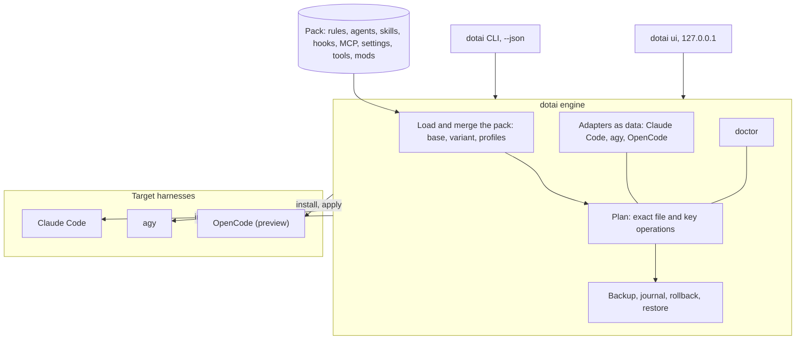
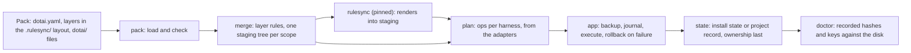

# Architecture

- **Status:** describes the engine as built, on `main`.
- **verified-at:** 2026-11-18
- **covers:** [0004](decisions/0004-installer-language-and-shape.md) (partial), [0007](decisions/0007-always-on-context-budget.md) (proposed), [0010](decisions/0010-engine-and-pack-separated.md), [0011](decisions/0011-mods-always-project-scoped.md), [0012](decisions/0012-rules-file-per-harness.md), [0013](decisions/0013-renderer-merges-by-key.md), [0016](decisions/0016-review-via-external-tracker.md), [0017](decisions/0017-pack-variants-as-layers.md), [0018](decisions/0018-install-modes-and-mandatory-backup.md), [0019](decisions/0019-v1-harness-targets.md), [0020](decisions/0020-v1-scope-engine-and-pack.md), [0021](decisions/0021-go-engine-orchestrates-rulesync.md), [0022](decisions/0022-pack-format-and-manifest.md), [0023](decisions/0023-flat-profiles-and-layer-merge-rules.md), [0024](decisions/0024-models-declared-per-harness-no-tiers.md), [0025](decisions/0025-settings-as-per-harness-passthrough.md), [0027](decisions/0027-loose-files-and-plugins-only-for-mods.md), [0028](decisions/0028-plan-centric-hexagonal-engine.md), [0029](decisions/0029-rulesync-checksums-embedded-in-the-engine.md), [0031](decisions/0031-isolated-install-root.md), [0032](decisions/0032-install-state-backup-and-isolated-launch.md), [0034](decisions/0034-replace-mode-in-v1.md), [0038](decisions/0038-replace-mode-resets-harness-to-fresh-install.md), [0039](decisions/0039-base-layer-installs-skills-at-user-level.md), [0041](decisions/0041-project-scope-local-and-untracked.md), [0042](decisions/0042-tag-driven-release-binaries.md), [0043](decisions/0043-local-web-ui.md), [0044](decisions/0044-git-pack-distribution.md), [0045](decisions/0045-dotai-owned-project-onboarding.md), [0046](decisions/0046-pack-templates-and-wizard.md), [0049](decisions/0049-claude-user-mcp-servers-in-claude-json.md), [0050](decisions/0050-hook-entries-owned-one-by-one.md)

This document is a map, not an atlas. The why lives in the [decision records](decisions/README.md), the pack contract in [PACK-FORMAT.md](PACK-FORMAT.md), and the machine-readable output in [CLI-JSON.md](CLI-JSON.md). Anything not built yet is marked as such.

**Decision references.** "Decision NNNN", "0035" and similar, in these docs and in code comments, refer to the record `docs/decisions/NNNN-*.md`; the [decision index](decisions/README.md) lists them all.

## 1. What it is

`dotai` is a Go binary that renders a single configuration source (rules, agents, skills, hooks, MCP servers, settings, profiles) to Claude Code, agy (Google Antigravity CLI) and OpenCode. OpenCode support is a preview: rulesync's generated OpenCode hooks plugin does not pass a `sessionStart` hook's output to the model (an upstream fix, [dyoshikawa/rulesync#3926](https://github.com/dyoshikawa/rulesync/pull/3926), is pending), and in `opencode run` and `opencode serve` `sessionStart` races plugin startup, so the first request of a session can start before the hook has run. The pinned rulesync, 43.10.0, fixed the hooks that read stdin and enforces hook timeouts ([HARNESS-NOTES](HARNESS-NOTES.md#rulesync-43100)). Everything opinionated (policies, modules, workflows) comes from a pack; the engine contains nothing personal ([0010](decisions/0010-engine-and-pack-separated.md)). Controlled token consumption is a central goal: every always-on piece should justify its cost ([0007](decisions/0007-always-on-context-budget.md), proposed).

## 2. Overview

dotai loads a pack and applies it to the target harnesses ([0010](decisions/0010-engine-and-pack-separated.md)), using a pinned rulesync binary for rendering ([0021](decisions/0021-go-engine-orchestrates-rulesync.md)). The engine's v1 scope is in [0020](decisions/0020-v1-scope-engine-and-pack.md), widened by the replace mode ([0034](decisions/0034-replace-mode-in-v1.md)) and the web UI ([0043](decisions/0043-local-web-ui.md)). Review tools are external and declared by the pack ([0016](decisions/0016-review-via-external-tracker.md)). The harnesses are the targets ([0019](decisions/0019-v1-harness-targets.md)); environment-specific setups, such as an optional orchestrator, are pack variants applied as layers ([0017](decisions/0017-pack-variants-as-layers.md)).



## 3. How a command runs

Every command that writes builds a plan first: the exact file and key operations it will carry out, decided before anything is written ([0028](decisions/0028-plan-centric-hexagonal-engine.md)). `--dry-run`, `--json`, the web UI's previews and `doctor` read the same plan.



- **Pack source.** A pack is YAML and Markdown in the `.rulesync/` layout, with per-harness blocks in the frontmatter (`claudecode:`, `opencode:`, and for agy `antigravity-cli:` in subagents and `antigravity:` in rules) and a `dotai:` block with abstract capabilities, which dotai reads from the sources because rulesync strips it ([0021](decisions/0021-go-engine-orchestrates-rulesync.md), [0022](decisions/0022-pack-format-and-manifest.md), [HARNESS-NOTES](HARNESS-NOTES.md)).
- **Merge.** Profiles are flat and combinable; layers merge by the rules of [0023](decisions/0023-flat-profiles-and-layer-merge-rules.md), with hooks and permissions as a union in layer order ([0040](decisions/0040-list-files-merged-as-a-union.md)). The result is one staging tree for the user scope (base and variant) and one for the project scope (profiles).
- **Rendering.** rulesync renders rules, commands, subagents, skills, MCP, hooks and permissions into the staging directory; dotai writes what rulesync does not cover: per-harness settings such as `statusLine` and `env` ([0025](decisions/0025-settings-as-per-harness-passthrough.md)), tools and their path variables ([0030](decisions/0030-tools-paths-and-project-config.md), [0037](decisions/0037-tool-commands-resolved-per-os.md)), mod plugin manifests, and the onboarding skill and hook ([0045](decisions/0045-dotai-owned-project-onboarding.md)). The rulesync binary is downloaded once and used only when its SHA-256 matches the table embedded in the engine ([0029](decisions/0029-rulesync-checksums-embedded-in-the-engine.md)).
- **Rules file per harness.** `CLAUDE.md` for Claude Code and `AGENTS.md` for agy and OpenCode at user level, from the same source ([0012](decisions/0012-rules-file-per-harness.md)); at project level, local rules files that are never committed ([0041](decisions/0041-project-scope-local-and-untracked.md)).
- **Claude Code emission.** Skills, commands, agents, hooks and MCP as loose files; mods as project-scoped plugins under `.claude/skills/<mod>/`, copied whole from the pack's `mods/<mod>/` ([0027](decisions/0027-loose-files-and-plugins-only-for-mods.md), [PACK-FORMAT](PACK-FORMAT.md#mods)).
- **Merge by key.** In a file the harness or the user also writes, such as a harness's settings file or Claude Code's `.claude.json`, where each user-scope MCP server is a key, or in a harness's hook files, where each hook group of Claude Code's `settings.json` and each top-level key of agy's `hooks.json` is one, dotai owns only the keys and entries the pack puts there, records them, and never deletes foreign entries, such as the hooks another program registers ([0013](decisions/0013-renderer-merges-by-key.md), [0035](decisions/0035-settings-files-owned-by-key.md), [0049](decisions/0049-claude-user-mcp-servers-in-claude-json.md), [0050](decisions/0050-hook-entries-owned-one-by-one.md)). JSON and JSONC edits go through `internal/plan/jsonc`, on top of `tailscale/hujson`, which keeps comments, key order and line endings.

### User scope: `dotai install`

The plan covers each staged file: created, replaced, removed (a file the previous install owned that the pack no longer stages) or left unchanged, in its harness's directory. An owned file the user edited stops the plan. The install detects each harness of the pack by its command on `PATH` and its configuration directory, and manages the ones found, or those `--harness` names ([0038](decisions/0038-replace-mode-resets-harness-to-fresh-install.md)).

- **Isolated mode** (the default): files go under `~/.dotai/isolated/<harness>/` ([0031](decisions/0031-isolated-install-root.md)), and tools under `~/.dotai/tools/`. `dotai run <harness>` launches the harness against that directory, with the variables or flags that point it there ([0032](decisions/0032-install-state-backup-and-isolated-launch.md)). Each adapter states how far isolation holds and what of the user's own setup still leaks in ([0018](decisions/0018-install-modes-and-mandatory-backup.md)).
- **Replace mode** (`--mode replace`): resets each selected harness to a fresh install, moving every entry not on the adapter's keep-list into the backup, then installs the pack into the harness's own configuration directory ([0034](decisions/0034-replace-mode-in-v1.md), [0038](decisions/0038-replace-mode-resets-harness-to-fresh-install.md)). That reset is the first replace install of a harness; a later one only updates the pack and wipes nothing unless `--reset` or the user asks for a reset again ([0051](decisions/0051-later-replace-install-updates-unless-reset.md)). It needs consent for what it wipes or overwrites, refuses while a harness it resets is running, and keeps the first replace backup forever.

`dotai install` backs up every target it replaces or removes, executes the plan with a journal and a rollback from that backup on failure, and writes the install state, with its ownership record, last (`~/.dotai/state.json`). `dotai restore` undoes installs from the backups, newest first ([0033](decisions/0033-restore-from-the-install-history.md)). Formats are in [CLI-JSON](CLI-JSON.md#install-state).

### Project scope: `dotai apply`

The project scope ([0041](decisions/0041-project-scope-local-and-untracked.md)) has its own plan, shown by `dotai apply --profile <p> --dry-run` in a project. The adapters carry each harness's project layout as data: the local target of each kind rulesync renders, the files merged by key, Claude Code's MCP keys in its `.claude.json`, the slots a harness lacks, and where same-name user items live. `plan` places the staged project tree there and lists the `.git/info/exclude` entries, and `app` asks git, through a port, which targets the repository tracks, so that none of them is ever written.

`dotai apply --profile <p>` carries the plan out as an install does, under the lock, after a backup and a journal, with a rollback on any failure. It owns, in the project's record under the home directory (`~/.dotai/projects/<project id>/record.json`, never in the project, which a repository could ship), each file it wrote and each key it set with the value the key had before. A later apply removes what a dropped profile gave, and `dotai restore --project` puts the project back as before its first apply. The keys it owns in a harness's home file, such as Claude Code's MCP servers in `~/.claude.json`, are listed in `~/.dotai/projects.json`, which a replace install reads to keep them.

### Packs: `dotai pack`

The pack registry is `~/.dotai/packs.json`. A pack is added from a github.com repository, fetched with the user's own git into `~/.dotai/packs/<identity>`, or from a local directory, which stays where it is ([0044](decisions/0044-git-pack-distribution.md)). `dotai pack update` shows what changed in the pack's executable content (hooks, MCP servers, settings, tools, mods) before it swaps the clone. A new pack starts from one template embedded in the engine and versioned with it, through `dotai pack new` or the web UI's wizard; a pack file left exactly as the template wrote it is flagged `template-unchanged` and needs consent to install ([0046](decisions/0046-pack-templates-and-wizard.md), [PACK-FORMAT](PACK-FORMAT.md#creating-a-pack)).

### Web UI: `dotai ui`

A local web page served on `127.0.0.1` by `internal/server`, an adapter beside `internal/cli` that calls `internal/app` directly and answers with the same envelope as `--json` ([0043](decisions/0043-local-web-ui.md)). Every request is checked for its Host, its Origin and a session token traded for a one-time code. Every action is shown as its plan first and carried out only as that plan, by its digest. The API is in [CLI-JSON](CLI-JSON.md#web-ui-api).

## 4. Code map

The package tree, as `go list ./...` reports it (module `github.com/lartweib/dotai`):

```
cmd/dotai/              main only: wires cli.Run, and server.Run as dotai ui
internal/
  cli/                  cobra commands: flags, text output and the --json envelope; calls app
  server/               dotai ui: local HTTP API, guards, session; embeds the frontend
                        (web/: HTML, CSS, ES modules, fonts; webtest/: Node tests of pure modules)
  envelope/             versioned --json envelope, error codes and shared outcomes; used by cli and server
  app/                  use cases: validate, stage, install, apply, restore, doctor, run, pack,
                        onboarding; ports to the disk, git, rulesync and the process list
  pack/                 manifest, layers, dotai: blocks and onboarding; reads through fs.FS, no I/O
  packtemplate/         the embedded pack template and the hashes of its files (0046)
  merge/                layer merge rules, settings and tool commands, one staging tree per scope (pure)
  plan/                 plan model for the user and project scopes, exclude entries (pure)
  plan/jsonc/           key-by-key JSON and JSONC edits over hujson that keep every other byte
  harness/              each harness as data: rulesync target, isolation, user, replace and project layouts
  backup/               backup manifests of installs and project operations (no I/O)
  state/                install state, project records and onboarding records (no I/O)
  rulesync/             pinned rulesync binary: embedded checksums, download, cache, run
  proc/                 the running-process list for the running-harness check, without cgo
scripts/release.sh      builds the release archives and SHA256SUMS (0042)
```

- `cli` and `server` are two adapters over `app`: neither imports the other, and both report results and errors through `envelope`, so that a command and its endpoint give the same `data` and error codes. `main` connects them: `cli` reaches the server only through a function in its `Env`.
- `pack`, `merge`, `plan`, `harness`, `backup` and `state` hold the domain and do no I/O of their own. `app` holds the use cases and the ports: the disk (writes through `os.Root`, so nothing leaves the directory it belongs to), git, rulesync and the process list. A test replaces a port with a fake through `app.Ports`.
- OS-specific code sits in files with a build constraint or an OS suffix (`_windows.go`, `_linux.go`, `_other.go`), in `app`, `cli` and `proc`.
- Releases are built by `scripts/release.sh` and published by `.github/workflows/release.yml` from a `vX.Y.Z` tag ([0042](decisions/0042-tag-driven-release-binaries.md)).

Not built yet:

- A `doctor` check of the always-on context budget against caps the pack declares ([0007](decisions/0007-always-on-context-budget.md), proposed).
- Stack detection by the engine during onboarding; the generated profiling skill does it ([0020](decisions/0020-v1-scope-engine-and-pack.md), [0045](decisions/0045-dotai-owned-project-onboarding.md)).
- A generator for the decision index; it is kept by hand.

## 5. Project onboarding

Decided in [0008](decisions/0008-onboarding-by-detection-and-base-profile.md) and [0045](decisions/0045-dotai-owned-project-onboarding.md). dotai owns the procedure: `dotai install` generates the profiling skill `dotai-profiles` from the manifest's profiles and a `SessionStart` hook, `dotai onboarding hook`, in each harness, unless the pack declares `onboarding.custom` ([PACK-FORMAT](PACK-FORMAT.md#onboarding)). The hook compares a fingerprint of the repository with `.dotai/onboarding.json` and prints at most one line; the skill proposes, the user approves, and the engine applies, never picking a profile itself. Mods are always installed at project level (see the invariants).

```mermaid
sequenceDiagram
  participant U as User
  participant HK as dotai onboarding hook
  participant SK as dotai-profiles skill
  participant DA as dotai apply
  participant P as Project

  U->>HK: session starts in a git repository
  HK->>P: marker, onboarding record, git ls-files
  HK-->>SK: one line: not set up, or the profiles may no longer fit
  SK->>P: detect stack by content, hints as evidence only
  SK->>U: a few targeted questions, then the dry-run plan
  U-->>SK: approval, or dismissal
  SK->>DA: dotai apply --profile a,b
  DA->>P: profile agents, skills, MCP and mods; marker and fingerprint
  DA-->>U: summary of what was applied
```

## 6. Invariants

- Mods are always installed at project or local level, never at user level ([0011](decisions/0011-mods-always-project-scoped.md)).
- The base and the variant may install skills and agents at user level, within the always-on budget ([0007](decisions/0007-always-on-context-budget.md), proposed); profiles add the project-specific ones at project level ([0039](decisions/0039-base-layer-installs-skills-at-user-level.md), which on that point replaces [0008](decisions/0008-onboarding-by-detection-and-base-profile.md)).
- Single source of rules in the pack, rendered to `CLAUDE.md` in Claude Code and to `AGENTS.md` in agy and OpenCode ([0012](decisions/0012-rules-file-per-harness.md), which on that point replaces [0003](decisions/0003-align-with-official-standards.md)).
- The renderer never rewrites a file with foreign content: it merges by key and only removes what it recorded as its own ([0013](decisions/0013-renderer-merges-by-key.md)).
- The project scope stays local: nothing is written into a file git tracks, and every file written is excluded through `.git/info/exclude` ([0041](decisions/0041-project-scope-local-and-untracked.md)).
- Every write is backed up first and can be undone with `dotai restore` ([0018](decisions/0018-install-modes-and-mandatory-backup.md), [0032](decisions/0032-install-state-backup-and-isolated-launch.md)).
- The engine knows no specific tool; anything tool-specific is a pack variant ([0017](decisions/0017-pack-variants-as-layers.md)).

## 7. Boundaries and external integrations

dotai does not control these surfaces: it uses them and can break if they change. Verified facts, each with the version and OS it was checked on, are in [HARNESS-NOTES.md](HARNESS-NOTES.md).

| System | What dotai uses | Source and notes |
|---|---|---|
| **rulesync** | Pinned binary that renders rules, commands, subagents, skills, MCP, hooks and permissions into staging; per-target frontmatter blocks; strips the `dotai:` block | [0021](decisions/0021-go-engine-orchestrates-rulesync.md), [0029](decisions/0029-rulesync-checksums-embedded-in-the-engine.md). Version pinned per pack in `dotai.yaml` ([0022](decisions/0022-pack-format-and-manifest.md)) |
| **Claude Code** | `CLAUDE.md`, loose skills, commands, agents and hooks, mods as plugins, `settings.json` keys (`permissions`, `env`, `statusLine`, hooks), MCP servers in `.claude.json`; `CLAUDE_CONFIG_DIR` for isolation | [0012](decisions/0012-rules-file-per-harness.md), [0013](decisions/0013-renderer-merges-by-key.md), [0025](decisions/0025-settings-as-per-harness-passthrough.md), [0027](decisions/0027-loose-files-and-plugins-only-for-mods.md) |
| **agy** | `AGENTS.md`, `.agents/rules/`, skills, MCP configuration, hooks, user settings; the `--gemini_dir` flag for isolation | [0012](decisions/0012-rules-file-per-harness.md), [0025](decisions/0025-settings-as-per-harness-passthrough.md), [0031](decisions/0031-isolated-install-root.md) |
| **OpenCode** (preview) | `AGENTS.md`, agents, commands, skills, MCP and settings in `opencode.jsonc`; the `XDG_*` directories for isolation | [0019](decisions/0019-v1-harness-targets.md), [0018](decisions/0018-install-modes-and-mandatory-backup.md). Preview until rulesync's generated OpenCode hooks plugin is fixed upstream |
| **git** | The user's git, 2.41 or later, to fetch git packs and to ask which project files are tracked | [0041](decisions/0041-project-scope-local-and-untracked.md), [0044](decisions/0044-git-pack-distribution.md) |

## Maintenance

Review this file when a decision listed in `covers` changes, or when a package is added, removed or renamed: regenerate the code map from `go list ./...`.
