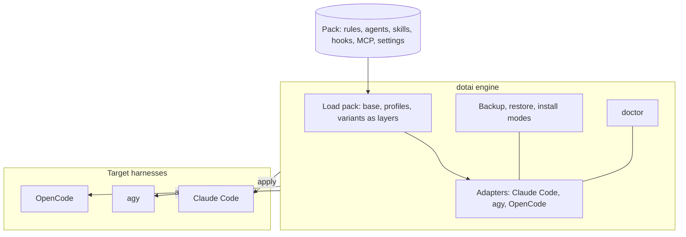
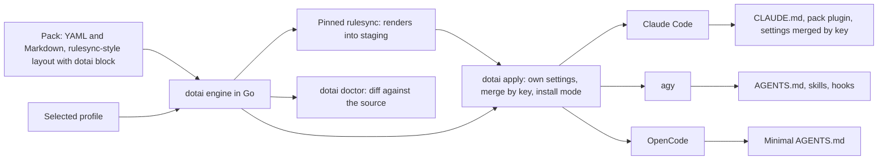

# Architecture

- **Status:** design, no code. Describes the planned v1 architecture of the engine as decided.
- **verified-at:** 2026-10-26
- **covers:** [0004](decisions/0004-installer-language-and-shape.md) (partial), [0007](decisions/0007-always-on-context-budget.md) (proposed), [0008](decisions/0008-onboarding-by-detection-and-base-profile.md), [0010](decisions/0010-engine-and-pack-separated.md), [0011](decisions/0011-mods-always-project-scoped.md), [0012](decisions/0012-rules-file-per-harness.md), [0013](decisions/0013-renderer-merges-by-key.md), [0016](decisions/0016-review-via-external-tracker.md), [0017](decisions/0017-pack-variants-as-layers.md), [0018](decisions/0018-install-modes-and-mandatory-backup.md), [0019](decisions/0019-v1-harness-targets.md), [0020](decisions/0020-v1-scope-engine-and-pack.md), [0021](decisions/0021-go-engine-orchestrates-rulesync.md), [0022](decisions/0022-pack-format-and-manifest.md), [0023](decisions/0023-flat-profiles-and-layer-merge-rules.md), [0024](decisions/0024-models-declared-per-harness-no-tiers.md), [0025](decisions/0025-settings-as-per-harness-passthrough.md), [0026](decisions/0026-json-cli-and-ui-after-v1.md), [0027](decisions/0027-loose-files-and-plugins-only-for-mods.md), [0028](decisions/0028-plan-centric-hexagonal-engine.md), [0034](decisions/0034-replace-mode-in-v1.md), [0038](decisions/0038-replace-mode-resets-harness-to-fresh-install.md), [0039](decisions/0039-base-layer-installs-skills-at-user-level.md)

This document is a map, not an atlas. The why lives in the [decision records](decisions/README.md) and the pack contract in [PACK-FORMAT.md](PACK-FORMAT.md). Anything not yet decided is marked as pending. Anything not stated by a source document is marked `(inferred)`.

The runtime of the reference pack (delegation, hooks, review, task router) is described in its own repository: [RUNTIME.md](../../dotai-lartweib-pack/docs/RUNTIME.md).

## 1. What it is

`dotai` is a Go binary that renders a single configuration source (rules, agents, skills, hooks, settings, profiles) to Claude Code, agy and OpenCode. Everything opinionated (policies, modules, workflows) comes from a pack; the engine contains nothing personal ([0010](decisions/0010-engine-and-pack-separated.md)). Controlled token consumption is a central goal: every always-on piece justifies its cost ([0007](decisions/0007-always-on-context-budget.md), proposed).

## 2. Overview

dotai is a Go engine that loads a pack and applies it to the target harnesses ([0010](decisions/0010-engine-and-pack-separated.md)), using a pinned rulesync for rendering ([0021](decisions/0021-go-engine-orchestrates-rulesync.md)). The engine's v1 scope is in [0020](decisions/0020-v1-scope-engine-and-pack.md). Review tools are external and declared by the pack ([0016](decisions/0016-review-via-external-tracker.md)). The harnesses are the targets ([0019](decisions/0019-v1-harness-targets.md)); environment-specific setups, such as an optional orchestrator, are pack variants applied as layers ([0017](decisions/0017-pack-variants-as-layers.md)).



## 3. Planned code map

There is no code yet. Decided so far: the shape ([0004](decisions/0004-installer-language-and-shape.md), in force where 0020 does not replace it, 0010 to 0013, and 0021):

- **Separate engine and packs** ([0010](decisions/0010-engine-and-pack-separated.md)): the engine is an own, minimal Go binary that orchestrates a pinned rulesync binary for rendering ([0021](decisions/0021-go-engine-orchestrates-rulesync.md)); packs are YAML + Markdown, and nothing personal goes into Go.
- **Pack source in the `.rulesync/` layout:** per-harness blocks in the frontmatter (`claudecode:`, `opencode:`, and for agy `antigravity-cli:` in subagents and `antigravity:` in rules) and a `dotai:` block with abstract capabilities, which dotai reads from the sources because rulesync strips it ([0021](decisions/0021-go-engine-orchestrates-rulesync.md), [HARNESS-NOTES](HARNESS-NOTES.md)).
- **Rendering:** rulesync renders rules, commands, subagents, skills, MCP, hooks and permissions into a staging directory; dotai renders what rulesync does not cover (settings such as `statusLine` and `env`, plugins, tools and their path variables, [0030](decisions/0030-tools-paths-and-project-config.md)) and applies everything with merge by key and the active install mode ([0021](decisions/0021-go-engine-orchestrates-rulesync.md)).
- **Rules file per harness:** `CLAUDE.md` for Claude Code and `AGENTS.md` for agy and OpenCode, from the same source ([0012](decisions/0012-rules-file-per-harness.md)).
- **Emission in Claude Code:** skills, commands, agents, hooks and MCP as loose files; mods as project-scoped plugins under `.claude/skills/<mod>/`, copied whole from the pack's `mods/<mod>/` ([0027](decisions/0027-loose-files-and-plugins-only-for-mods.md), [PACK-FORMAT](PACK-FORMAT.md#mods)); `permissions`, `env` and `statusLine` in settings, merged by key with an ownership record and without deleting foreign entries ([0013](decisions/0013-renderer-merges-by-key.md)).
- `dotai apply --harness claude|opencode|agy --profile <profile> [--project .]`; to use another pack, for example `--pack <source>` ([0010](decisions/0010-engine-and-pack-separated.md); exact form pending).
- Every command offers `--json` output ([0026](decisions/0026-json-cli-and-ui-after-v1.md)). A local web UI, `dotai ui`, is planned for v1 (proposed in [0043](decisions/0043-local-web-ui.md); 0026 had placed a UI after v1). It is a thin layer over the same functions: a local web page, served on `127.0.0.1` by `internal/server`, an adapter beside `internal/cli` that calls `internal/app` and answers with the same envelope ([0043](decisions/0043-local-web-ui.md)).
- A new pack starts from one template embedded in the engine and versioned with it, through `dotai pack new` or the web UI's wizard; the engine keeps the hashes of the template's files, so that a pack file left as the template wrote it is flagged `template-unchanged` and needs consent to install ([0046](decisions/0046-pack-templates-and-wizard.md), [PACK-FORMAT](PACK-FORMAT.md#creating-a-pack)).
- `dotai doctor`: diffs the generated output against the source. It is planned to also measure the first-request budget and fail if it exceeds the cap the pack declares ([0007](decisions/0007-always-on-context-budget.md), proposed).
- `dotai decision` (numbers decisions and regenerates the decision index) and `dotai skills get <x>`: a skill can ship as a stub whose `SKILL.md` holds only the description and loads its full guide from the binary, so the always-on cost is only the description and the guide does not drift from the code (the pattern Orca uses with `orca skills get <x>`). Exact subcommands: pending design.



### Code structure

Decided in [0028](decisions/0028-plan-centric-hexagonal-engine.md). Every command builds a plan (the exact file and key operations), then backs up its targets and executes it; `--dry-run`, `--json` and `doctor` read the same plan.

```
cmd/dotai/        main only; wires cli.Run, and server.Run as dotai ui
internal/
  cli/            cobra commands: flags only; calls app
  server/         dotai ui: local HTTP API and embedded frontend (web/: HTML, CSS, ES modules, fonts); calls app
  envelope/       versioned --json envelope, error codes and shared outcomes
                  (CLI-JSON.md); used by cli and server
  app/            use cases: install, apply, validate, doctor, restore
  pack/           manifest, layers, dotai: blocks (no I/O, fs.FS)
  merge/          layer merge rules, staging per scope (pure)
  render/         settings, tools, path variables, mod plugin.json
  plan/           plan model, diff, JSON/JSONC key merge (pure)
  backup/  state/ backups and restore; ownership record
  harness/        Adapter port + claudecode, antigravity, opencode
  rulesync/       pinned binary: download, checksum, run
  platform/       filesystem, processes, env, OS paths
```

`cli` and `server` are two adapters over `app`: neither imports the other, and both report results and errors through `envelope`, so that a command and its endpoint give the same `data` and error codes ([0043](decisions/0043-local-web-ui.md)). `main` connects them: `cli` reaches the server only through a function in its `Env`.

JSON and JSONC key edits use `tailscale/hujson` plus a small own edit layer in `plan`, which keeps comments, key order and line endings ([0028](decisions/0028-plan-centric-hexagonal-engine.md)).

The plan so far covers the user scope of an install: each staged file is created, replaced or left unchanged in its harness's directory, under `~/.dotai/isolated/` in the isolated mode ([0031](decisions/0031-isolated-install-root.md)) or the harness's own configuration directory in the replace mode, and tools in `~/.dotai/tools/`. The harness adapters carry both layouts as data, with the keep-lists, leak entries and relocation variables of the replace mode, and the install detects each harness of the pack by its command on `PATH` and its configuration directory to select the ones it manages ([0038](decisions/0038-replace-mode-resets-harness-to-fresh-install.md)). A file the previous install owned that the pack no longer stages is removed, and an owned file the user edited stops the plan. `dotai install` carries the plan out: it backs up, executes with a rollback from that backup on failure, and records the install state with its ownership record last ([0032](decisions/0032-install-state-backup-and-isolated-launch.md); formats in [CLI-JSON](CLI-JSON.md#install-state)). Key-level merges come with the project scope (roadmap PR 10). The replace mode, also in v1, uses the same plan, journal and restore over the harness's real configuration directories: it resets each selected harness to a fresh install, wiping every entry not on the adapter's keep-list into a backup by move, then installs the pack ([0034](decisions/0034-replace-mode-in-v1.md), [0038](decisions/0038-replace-mode-resets-harness-to-fresh-install.md), roadmap PRs 9b-1 to 9b-4). So far its plan exists, shown by `dotai install --mode replace --dry-run`; carrying it out comes with the backup by move.

The project scope ([0041](decisions/0041-project-scope-local-and-untracked.md)) has its own plan, shown by `dotai apply --profile <p> --dry-run` in a project: the adapters carry each harness's project layout as data (the local target of each kind rulesync renders, the files merged by key, Claude Code's MCP keys in its `.claude.json`, the slots a harness lacks, where same-name user items live), `plan` places the staged project tree there and lists the `.git/info/exclude` entries, and `app` asks git, through a port, which targets the repository tracks, so that none of them is ever written. `dotai apply --profile <p>` carries it out as an install carries out its plan, under the lock, after a backup and a journal, with a rollback on any failure: it owns, in the project's record under the home directory (`~/.dotai/projects/<project id>/record.json`, never in the project, which a repository could ship), each file it wrote and each key it set with the value the key had before, so that a later apply removes what a dropped profile gave and `dotai restore --project` puts the project back as before its first apply. The keys it owns in a harness's home file, such as Claude Code's MCP servers in `~/.claude.json`, are listed in `~/.dotai/projects.json`, which a replace install reads to keep them.

Pending:

- Pack format: decided in [0022](decisions/0022-pack-format-and-manifest.md), specified in [PACK-FORMAT.md](PACK-FORMAT.md). Models are declared per harness in each subagent, without tiers ([0024](decisions/0024-models-declared-per-harness-no-tiers.md)). Settings are per-harness blocks merged as-is ([0025](decisions/0025-settings-as-per-harness-passthrough.md)).

## 4. Project onboarding

Decided in [0008](decisions/0008-onboarding-by-detection-and-base-profile.md) and [0045](decisions/0045-dotai-owned-project-onboarding.md). dotai owns the procedure: `dotai install` generates the profiling skill `dotai-profiles` from the manifest's profiles and a `SessionStart` hook, `dotai onboarding hook`, in each harness, unless the pack declares `onboarding.custom` ([PACK-FORMAT](PACK-FORMAT.md#onboarding)). The hook compares a fingerprint of the repository with `.dotai/onboarding.json` and prints at most one line; the skill proposes, the user approves, and the engine applies, never picking a profile itself. Mods are always installed at project level (invariant, see §5).

```mermaid
sequenceDiagram
  participant U as User
  participant HK as dotai onboarding hook
  participant SK as dotai-profiles skill
  participant DA as dotai apply
  participant P as Project

  U->>HK: session starts in a git repository
  HK->>P: marker, onboarding record, git ls-files
  HK-->>SK: one line: not set up, or the profiles may no longer fit
  SK->>P: detect stack by content, hints as evidence only
  SK->>U: a few targeted questions, then the dry-run plan
  U-->>SK: approval, or dismissal
  SK->>DA: dotai apply --profile a,b
  DA->>P: profile agents, skills, MCP and mods; marker and fingerprint
  DA-->>U: summary of what was applied
```

## 5. Invariants

- Mods are always installed at project or local level, never at user level ([0011](decisions/0011-mods-always-project-scoped.md)).
- The base and the variant may install skills and agents at user level, within the always-on budget ([0007](decisions/0007-always-on-context-budget.md), proposed); profiles add the project-specific ones at project level ([0039](decisions/0039-base-layer-installs-skills-at-user-level.md), which on that point replaces [0008](decisions/0008-onboarding-by-detection-and-base-profile.md)).
- Single source of rules in the pack, rendered to `CLAUDE.md` in Claude Code and to `AGENTS.md` in agy and OpenCode ([0012](decisions/0012-rules-file-per-harness.md), which on that point replaces [0003](decisions/0003-align-with-official-standards.md)).
- The renderer never rewrites a file with foreign content: it merges by key and only removes what it recorded as its own ([0013](decisions/0013-renderer-merges-by-key.md)).
- The engine knows no specific tool such as Orca; anything tool-specific is a pack variant ([0017](decisions/0017-pack-variants-as-layers.md)).

## 6. Boundaries and external integrations

dotai does not control these surfaces: it uses them and can break if they change. Verified facts are in [HARNESS-NOTES.md](HARNESS-NOTES.md).

| System | What dotai uses | Source and notes |
|---|---|---|
| **rulesync** | Pinned binary that renders rules, commands, subagents, skills, MCP, hooks and permissions into staging; per-target frontmatter blocks; strips the `dotai:` block | [0021](decisions/0021-go-engine-orchestrates-rulesync.md). Version pinned per pack in `dotai.yaml` ([0022](decisions/0022-pack-format-and-manifest.md)) |
| **Claude Code** | `CLAUDE.md`, plugins (skills, commands, agents, hooks, MCP, mods), `settings.json` (`permissions`, `env`, `statusLine`, hooks), `.mcp.json`. `claude agents` (agents view, in preview) and its `--json` output, which prints active sessions as a JSON array (verified with `claude agents --help`, Claude Code 2.1.309, 2026-10-23) | [0012](decisions/0012-rules-file-per-harness.md), [0013](decisions/0013-renderer-merges-by-key.md), [0025](decisions/0025-settings-as-per-harness-passthrough.md). New mods API with unassessed stability |
| **agy** | `AGENTS.md`, `.agents/rules/`, skills, plugins, MCP configuration, user settings | [0012](decisions/0012-rules-file-per-harness.md), [0025](decisions/0025-settings-as-per-harness-passthrough.md). agy hooks unverified |
| **OpenCode** | Minimal and occasional target | [0019](decisions/0019-v1-harness-targets.md). Pending: whether to evaluate Pi as an alternative harness is not decided |

## Maintenance

Review this file when a decision listed in `covers` changes or code appears. `dotai doctor` is planned to warn about the co-change and to validate Mermaid syntax if `mmdc` is available (internal research (not published) on ADR and architecture docs; a proposal, no decision).
